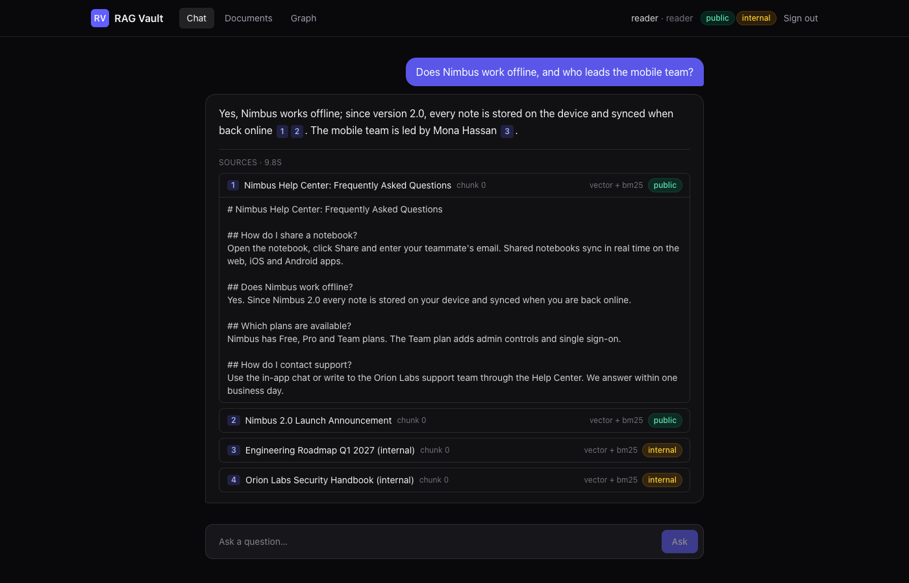
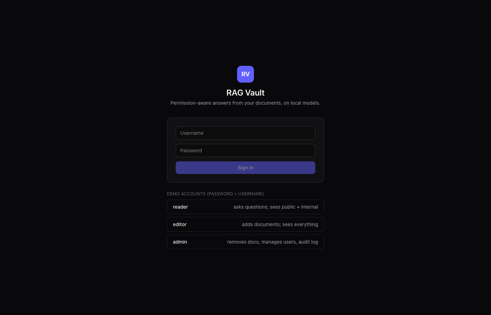
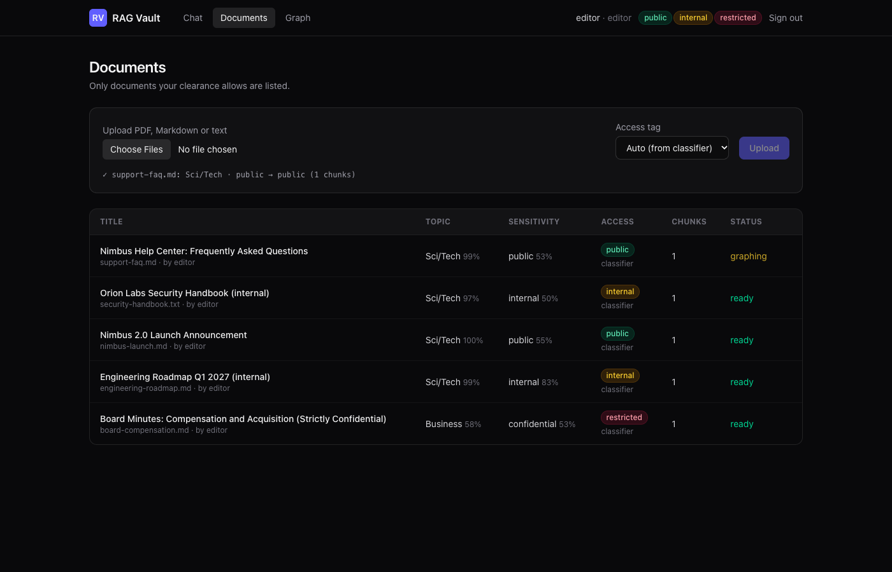
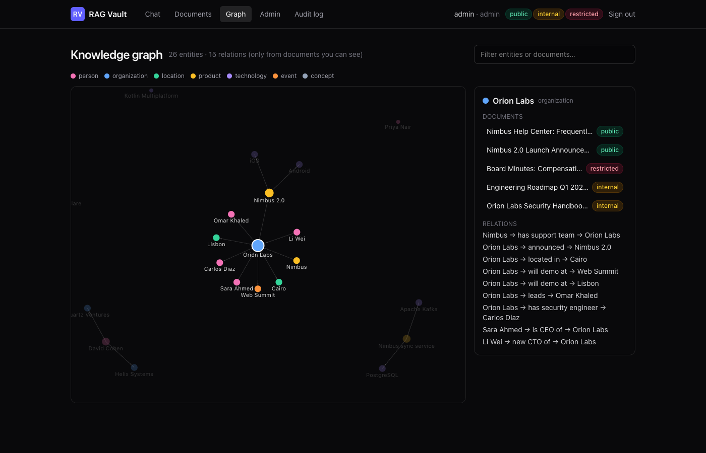
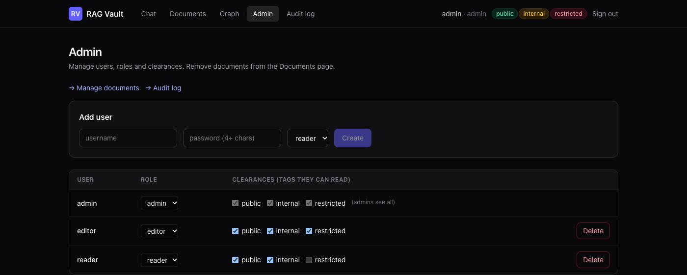
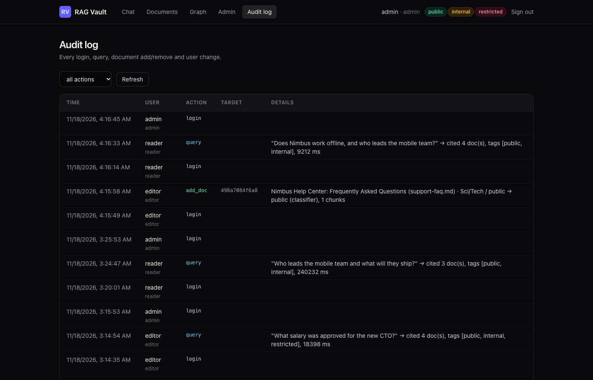
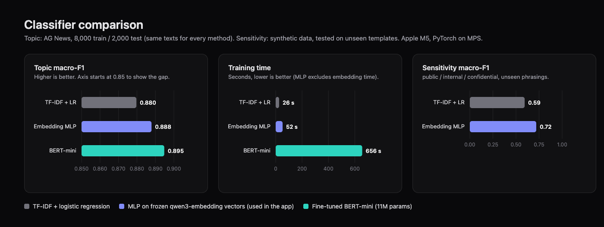

# RAG Vault

**Permission-aware RAG on local models: every answer cites its sources, users only retrieve what their clearance allows, and the knowledge base can be explored as an interactive graph.**

Everything runs on your machine through [Ollama](https://ollama.com). No cloud APIs.



## What it does (in simple words)

RAG Vault is a private search-and-answer tool for a company's documents. You upload files, then ask questions in plain language, and an AI that runs on your own computer answers using only those documents, with numbered links to the exact passages it used. Each person only gets answers from documents they are allowed to see: a new employee can't get the salary figures from confidential board minutes, even by asking cleverly. When a document is uploaded, a small AI model reads it and labels it as public, internal or confidential, so it gets the right protection automatically. You can also browse a map of the people, products and companies mentioned across all documents, and every action is recorded in a log.

**How it works**

1. **Upload:** an editor adds a PDF, Markdown or text file.
2. **Classify & index:** the file is split into passages, turned into vectors, labelled with a topic and sensitivity (which sets who can read it), stored in a vector database, and its people, companies and products are added to the knowledge graph.
3. **Ask:** a user asks a question; the search only looks at passages that user is allowed to read, and the local LLM writes an answer that cites them.

## Features

- **Roles:** `reader` asks questions. `editor` also adds documents. `admin` also removes documents, changes access tags, manages users, roles and clearances, and reads the audit log.
- **Access tags and clearances:** every document is `public`, `internal` or `restricted`. Each user has a set of clearances (the tags they may read). Admins read everything.
- **Permission filtering before retrieval:** the user's readable tags become a LanceDB pre-filter on vector search and limit the BM25 corpus, so restricted chunks never enter the candidate set. A final check drops anything outside the tags. Document lists, document detail (404, not 403, so existence doesn't leak) and the graph are filtered the same way.
- **Classifier sets the default tag:** a PyTorch MLP on the chunk embeddings labels topic and sensitivity (`public / internal / confidential`). Sensitivity sets the default tag (`confidential → restricted`). The most sensitive chunk decides for the whole document. Rules for secrets and personal data (SSNs, card numbers, API keys, private keys, `password:`) force `confidential`. Editors can override the tag at upload; admins can re-tag later.
- **Hybrid search:** cosine vector search plus BM25, fused with reciprocal rank fusion.
- **Cited answers:** `qwen3.5:4b` by default (`qwen3.5:9b` via an env var) cites every claim as `[n]`. Each citation shows the passage, document, chunk and which retriever found it.
- **Knowledge graph:** the local LLM extracts entities and relations per chunk (JSON mode). They are stored in SQLite and served through NetworkX. Removing a document removes its mentions, relations and any entity no longer mentioned anywhere.
- **Audit log:** logins (including failed ones), every query (question, allowed tags, cited docs, latency), document add/remove/re-tag, and user changes.
- **Web UI:** role login, chat with clickable citations, documents (upload / remove / re-tag), admin panel, audit log, force-directed graph (click a node to see its documents and relations).

## Architecture

```
INGEST
upload ─► parse (PDF/MD/TXT) ─► chunk ─► embed (qwen3-embedding:0.6b)
                                            │
                                            ├─► PyTorch classifier ─► topic + sensitivity ─► access tag
                                            ├─► LanceDB (chunks + vectors + access tag)
                                            └─► local LLM extracts entities/relations ─► graph (SQLite + NetworkX)

QUERY
question ─► user's readable tags ─┬─► LanceDB vector search (pre-filtered by tag) ─┐
                                  └─► BM25 over permitted chunks only ─────────────┴─► RRF ─► qwen3.5 answer with [n] citations
                                                                                                │
every add / remove / query ───────────────────────────────────────────────────────────────────► audit log (SQLite)
```

## Tech stack

| Layer | Tools |
|---|---|
| Backend | Python 3.12, FastAPI, uv |
| Local models | Ollama: `qwen3.5:4b` (answers, entity extraction), `qwen3-embedding:0.6b` (embeddings) |
| Retrieval | LanceDB (vectors + tag pre-filter), rank-bm25, reciprocal rank fusion |
| Graph | SQLite + NetworkX |
| ML | PyTorch on Apple MPS, Hugging Face Transformers, scikit-learn |
| Auth | PBKDF2 password hashes, JWT |
| Frontend | Next.js 16, React 19, Tailwind CSS 4, react-force-graph-2d |
| Tests | pytest (offline: fake embedder and LLM) |

## Quick start

**Requirements:** macOS or Linux, [uv](https://docs.astral.sh/uv/), Node.js 20+, and Ollama running with these models:

```bash
ollama pull qwen3.5:4b
```

```bash
ollama pull qwen3-embedding:0.6b
```

**1. Backend** (FastAPI on port 8710)

```bash
cd backend
uv sync
```

Train the classifiers. This writes `reports/classifier.md` and saves `models/topic_mlp.pt` and `models/sensitivity_mlp.pt`. The first run takes about 10–15 minutes: it downloads AG News and an 11M-parameter BERT, and embeds 10k texts with Ollama. Without these files the API still runs, but topic is `unknown` and sensitivity comes from the rules only.

```bash
uv run python -m ragvault.ml.compare
```

Start the API:

```bash
uv run uvicorn ragvault.api:app --port 8710
```

On first start three demo users are created, **password = username**: `reader`, `editor`, `admin`. Change them in the admin panel before using real data.

**2. Frontend** (Next.js on port 3710)

```bash
cd frontend
npm install
```

```bash
npm run dev -- --port 3710
```

Open http://localhost:3710.

**3. Demo documents** (optional, with the backend running). This uploads the fictional company documents in `samples/`: a public launch post, a public help-center FAQ, an internal roadmap, an internal security handbook and confidential board minutes.

```bash
cd backend && uv run python -m ragvault.load_samples
```

**Tests**

```bash
cd backend && uv run pytest -q
```

## Usage by role

| Role | What to try |
|---|---|
| **reader** (sees `public` + `internal`) | Open **Chat** and ask *"Who leads the mobile team and what will they ship?"*: you get a cited answer. Ask *"What salary was approved for the new CTO?"*: the answer is "I don't know", because the board minutes are `restricted`. **Graph** shows only entities from documents you can read. |
| **editor** (sees everything by default) | Upload PDF/MD/TXT on **Documents**; the classifier picks topic, sensitivity and the access tag, or you set the tag yourself. Ask the CTO question again and get the answer cited to the restricted minutes. |
| **admin** | On **Documents**, remove a document (its chunks and graph nodes go too) or change its tag. On **Admin**, create users, change roles and tick clearances. **Audit log** shows every login, query, upload and removal. |

## Results

Topic classification on [AG News](https://huggingface.co/datasets/fancyzhx/ag_news) (4 classes, balanced 8,000 train / 2,000 test, same texts for all methods, Apple M5 / MPS):

| Method | Accuracy | Macro-F1 | Train time |
|---|---|---|---|
| TF-IDF (1–2 gram) + logistic regression | 0.880 | 0.880 | 26 s |
| MLP on frozen `qwen3-embedding:0.6b` vectors | 0.888 | 0.888 | 52 s (+ embeddings) |
| Fine-tuned BERT-mini (11M params, all layers) | **0.895** | **0.895** | 656 s |

The app uses the embedding MLP. It reaches 99% of the fine-tuned model's F1, and it reuses the embeddings already computed for retrieval, so classifying costs almost nothing.

Sensitivity (synthetic data, tested on templates the model never saw): the embedding MLP reaches 0.72 macro-F1 against 0.59 for TF-IDF, with 100% recall on confidential documents.

Full report with confusion matrices and discussion: [`reports/classifier.md`](reports/classifier.md).

## Screenshots

All screenshots use the fictional demo documents in `samples/`.

**Login with roles:** one-click demo accounts for the three roles; each sees and can do different things.



**Upload (editor):** a new file is classified on upload; the FAQ was labelled Sci/Tech and *public*, so it got the `public` tag automatically. The table shows every document's topic, sensitivity, access tag and indexing status.



**Chat with citations (reader):** the answer cites numbered sources; clicking one shows the exact passage. The reader only gets `public` and `internal` sources, never the restricted board minutes.


**Knowledge graph:** people, companies, places and products extracted by the local LLM. Clicking *Orion Labs* lists the documents that mention it (with their access tags) and its relations.



**Admin panel:** create users, change roles, and tick which access tags each user may read. Documents are removed (with their chunks and graph nodes) from the Documents page.



**Audit log:** every login, upload and question is recorded, including which tags the user was allowed and how many documents were cited.



**Classifier results:** the three approaches on AG News, plus the sensitivity classifier (details in [`reports/classifier.md`](reports/classifier.md)).



## Configuration

All settings are environment variables (see `backend/src/ragvault/config.py`):

| Variable | Default |
|---|---|
| `RAGVAULT_CHAT_MODEL` | `qwen3.5:4b` (use `qwen3.5:9b` for better answers) |
| `RAGVAULT_EMBED_MODEL` | `qwen3-embedding:0.6b` (changing it requires re-training the classifier and re-ingesting) |
| `RAGVAULT_OLLAMA_URL` | `http://localhost:11434` |
| `RAGVAULT_DATA_DIR` | `./data` (SQLite, LanceDB, uploaded files) |
| `RAGVAULT_JWT_SECRET` | random, generated once into `data/.jwt_secret` |
| `RAGVAULT_GRAPH_MAX_CHUNKS` | `8` chunks per document sent to the LLM for entity extraction |
| `RAGVAULT_FAKE_MODELS` | set to `1` to run the API without Ollama (hashing embedder + fake LLM) |
| `NEXT_PUBLIC_API_URL` (frontend) | `http://localhost:8710` |

## Project structure

```
backend/src/ragvault/
  api.py           FastAPI routes and auth dependencies
  vault.py         ingest / remove / re-tag / query service
  auth.py          roles, permissions, clearances, password hashing, JWT
  store.py         LanceDB chunk store with tag pre-filtering
  search.py        hybrid retrieval (vector + BM25 + RRF) and cited answers
  graph.py         LLM entity/relation extraction, SQLite graph, NetworkX export
  classify.py      runtime topic/sensitivity classifier + secret/PII rules
  parse.py         PDF/MD/TXT extraction and chunking
  llm.py           Ollama clients + offline fakes
  db.py            SQLite schema: users, documents, audit, entities, mentions, relations
  load_samples.py  uploads samples/ through the API
  ml/              classifier experiments: data, PyTorch models, comparison script
backend/tests/     pytest suite
frontend/          Next.js UI (app/, components/, lib/)
reports/           classifier.md and raw results
samples/           fictional demo documents
docs/screenshots/  UI screenshots
```

**Tests cover:** a reader never retrieving a restricted document (citations, answer, document list, detail and graph); the raw retrievers only returning allowed tags; removing a document deleting its chunks, mentions, relations and orphaned entities while shared entities stay; role enforcement; clearance changes; manual tag override; audit entries; citations; chunking; secret-pattern escalation; validation of LLM output.

## Roadmap

- Train the sensitivity classifier on real labelled documents (the training code takes any `(text, label)` list).
- Switch BM25 to LanceDB's full-text index with a tag filter for corpora beyond a few thousand chunks.
- Extract entities from every chunk (currently the first 8 per document) and merge entities better than by normalised name.
- Per-document and group-based access on top of tags, plus SSO.
- Stream answers token by token in the chat.
- 3D graph view (planned with LiveMock AI).
